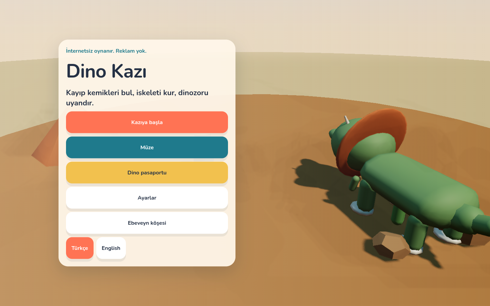
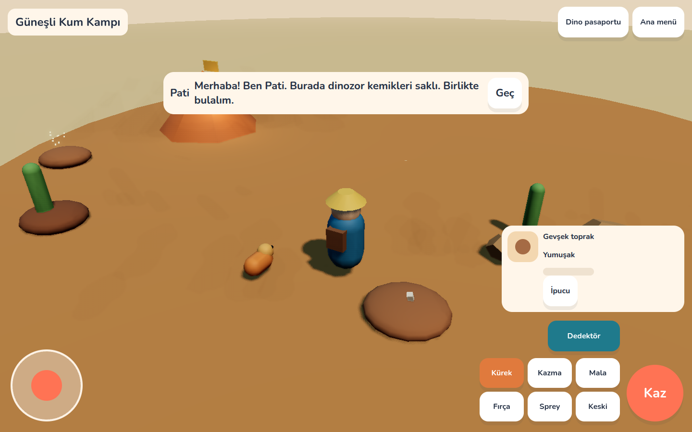
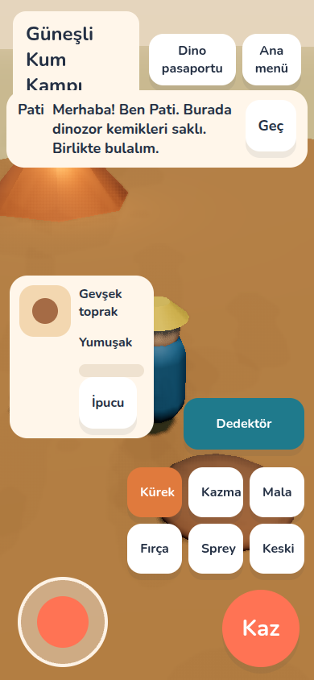
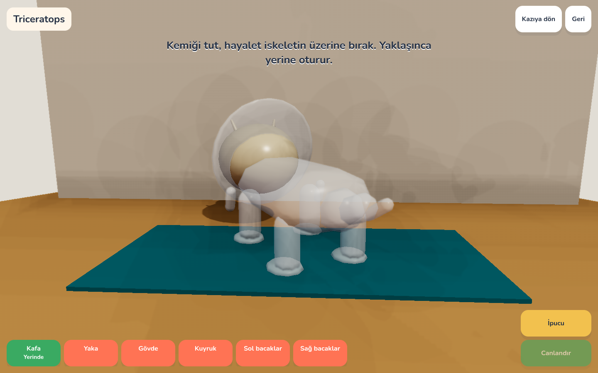
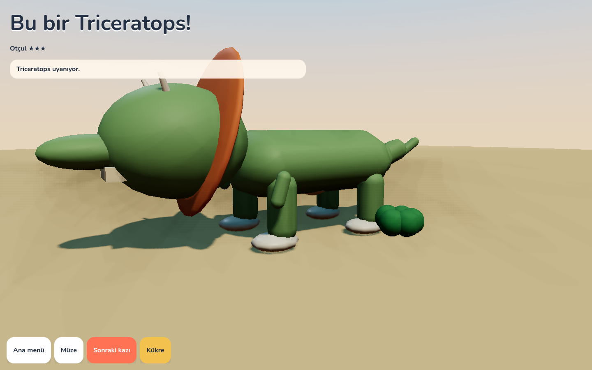
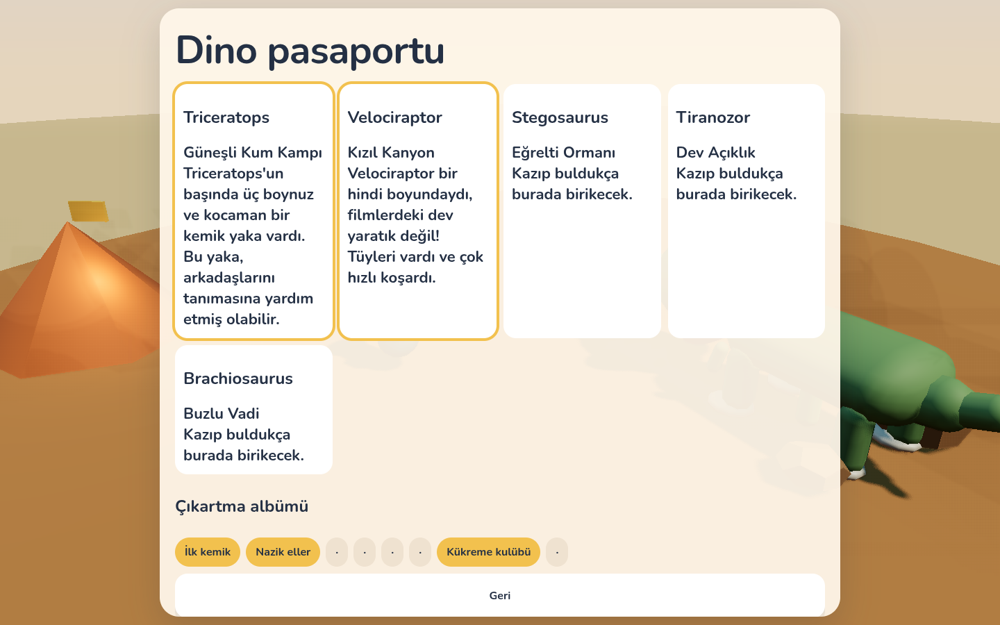

# Dino Kazı — görsel dil

Sıcak, büyük ve okunaklı. Kum, mercan ve çam yeşili. Gölgeler yumuşak, ışıltı az. Kemikler krem, kırılgan yerler pembe fırçayla anlatılır. Ekran görüntüleri Three.js prototipinden alındı (Godot 4.7 aynı JSON verisini ve aynı renkleri kullanır).

## Ana menü

Kamp, çadır ve Triceratops. Yazı büyük, düğmeler dolgun.

## Kazı

Silik ipuçları: kemik ucu, tümsek, farklı toprak. Alttaki aletler ve toprak kartı. Pati ilk adımı söyler.

Telefon düzeni aynı düğmeleri altta toplar.

## Müze

Hayalet iskelet. Bulunan kemik renkli düğmede durur. Doğru yuvaya bırakılınca kemik rengine döner.

## Uyanış

İsim, yıldız ve yemek. Otçulun yanında yapraklar durur.

## Pasaport

Beş dinozor, kısa bilgi ve çıkartmalar.

## Renkler

| Rol | Renk |
| --- | --- |
| Kum | `#e6c48a` |
| Mercan düğme | `#ff7354` |
| Deniz | `#1f7a8c` |
| Güneş | `#f2c14e` |
| Yaprak | `#3f8f4e` |
| Kemik | `#f3e6c4` |
| Mürekkep | `#243044` |

Alet renkleri veridedir: kürek turuncu, kazma kahve, mala altın, fırça pembe, sprey mavi, keski gri.
